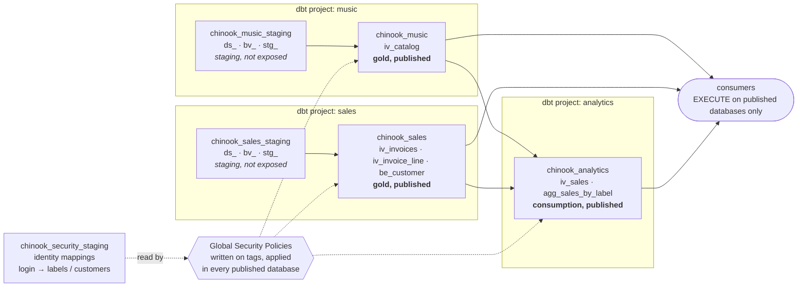
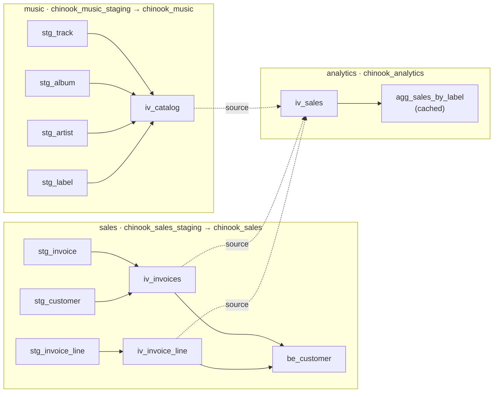
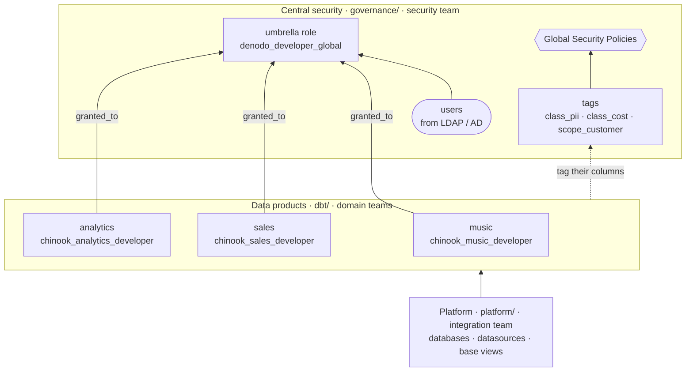

# Governed data mesh on Denodo, as code

A complete, reproducible data mesh on Denodo Virtual DataPort: three independent data products, each one a dbt project, and a governance layer built on Denodo **Tags** and **Global Security Policies** that is declared once, versioned in git, and applied everywhere the data travels, including in products that consume other products.

Verified live on Denodo VDP 9.4.7, dbt-core 1.12.6, dbt-denodo 1.0.0.

New to the subject? Start with the [walkthrough](docs/02_walkthrough.md) ([Word](docs/02_walkthrough.docx), [slides](docs/01_walkthrough-deck.pptx)): the same example told in five steps, without the technical detail. The [demo script](docs/03_demo-script.md) replays it command by command.

## What it shows

- **Data products as independent dbt projects.** Each product owns its databases, its published views, its contract and its access rules. No `ref()` crosses a project boundary.
- **Governance declared, not clicked.** A product says *"this column is personal data"* (a tag in its YAML); the governance team says *"personal data is masked like this"* (a Global Security Policy). Neither needs to know the other.
- **Policies follow the data across databases.** Denodo inspects every view of the query tree, in every database, when it applies Global Security Policies. The consumption product declares no rule of its own and still enforces all of them.
- **Drift made visible.** Two audits report what was changed by hand on the server and is not in the repository.

## Architecture



Each data product is one dbt project and two databases: a *staging* one that no consumer can open, and a *published* one. The analytics product has no source of its own: it reads the published views of the two others. The policies are written once, against tags, and Denodo applies them in every database a query goes through; the identity mappings they read are never exposed.

| Product | Purpose | Publishes |
|---|---|---|
| **music** | catalogue: track, album, artist, label, prices | `iv_catalog` |
| **sales** | invoicing: invoices, lines, customers | `iv_invoices`, `iv_invoice_line`, `be_customer` |
| **analytics** | consumption: no data of its own, joins the published views of the two others | `iv_sales`, `agg_sales_by_label` |

**A data product is two databases.** The *staging* database holds the datasources (`ds_`), the base views (`bv_`) and one cast-and-rename view per source table (`stg_`): no join, no filter, no logic. The *gold* database holds only what is published. Consumers get `EXECUTE` on gold databases and nothing else; the gold reads its staging through Denodo's indirect access, so the raw layer stays out of reach. That one rule is what makes "a policy on the gold is enough" true.

### Three folders, three owners

| Folder | Holds | Owner |
|---|---|---|
| `platform/` | virtual databases, datasources, base views | integration team |
| `governance/` | tag vocabulary, policies, users, identity mappings, the [governance register](GOVERNANCE.md) | federated governance |
| `dbt/` | the views of each product, the tags attached to its columns, its roles and privileges | domain teams |

The tag is the only point of contact between a product and the governance.

## Data model

This section is only about the data: what each product builds, and what dbt brings to it that Denodo alone does not have. Security comes in the next section.

### The models of the three products



| Product | Model | One row per | Built from |
|---|---|---|---|
| music | `iv_catalog` | track, with album, artist, label, price and cost | the four `stg_` views of the catalogue |
| sales | `iv_invoices` | invoice, with its customer | `stg_invoice` + `stg_customer` |
| sales | `iv_invoice_line` | track sold on an invoice | `stg_invoice_line` |
| sales | `be_customer` | customer, with number of invoices and units bought | `iv_invoices` + `iv_invoice_line` |
| analytics | `iv_sales` | invoice line, with customer, track, label, price and cost | the published views of music and sales |
| analytics | `agg_sales_by_label` | record label: units sold, revenue, margin | `iv_sales`, materialized in the Denodo cache |

**Staging: cast and rename, nothing else.** One `stg_` model per base view, in the staging database. It fixes the exact types once (prices as `decimal(10,2)`, keys as `integer`), so that every published view downstream relies on the same definitions:

```sql
-- dbt/dbt_music/models/staging/stg_track.sql
select
    cast(track_id    as integer)       as track_id,
    track_title,
    cast(album_id    as integer)       as album_id,
    cast(unit_price  as decimal(10,2)) as unit_price,
    cast(cost_price  as decimal(10,2)) as cost_price
from {{ source('bv_csv_music', 'bv_track') }}
```

**Published: joins and business entities.** The published database only contains what consumers may use, sorted into the VQL folders of the platform convention: `/30 Integration views` (`iv_`, joins of staging views), `/40 Business Entities` (`be_`, one row per business object) and `/50 Reporting Views` (`agg_`, aggregates).

**Between products: sources, never `ref()`.** The analytics project declares the published views of music and sales as dbt `sources`. It never reaches into another project's staging, and it never needs the other projects' code: each product keeps its own release cycle. A metric that needs two domains belongs to the consumer: that is why `be_customer` (sales) counts invoices and units, but not revenue. The price lives in music, so revenue is computed in analytics.

### What dbt adds to the model

Denodo virtualizes and serves the data. dbt adds what a software project expects around it, and the result is written back into Denodo where it matters.

**Tests, on every build.** Denodo declares no foreign key on these sources and runs no data test. Each project declares its tests next to its models, and `dbt build` runs them right after building each model:

| Test | Example | What it proves |
|---|---|---|
| `unique`, `not_null` | every key of every staging and published view | no duplicate, no missing identifier |
| `relationships` | `stg_invoice_line.invoice_id` → `stg_invoice.invoice_id`; a track points to an album, an album to an artist, an artist to a label | no orphan row: referential integrity across views |
| singular (a SQL file in `tests/`) | `assert_cost_below_unit_price`: no track is bought more expensive than it is sold | a business rule, written as a query that must return zero rows |

Measured: an invoice line pointing to invoice 99, which does not exist, was added to `data/invoice_line.csv`. Both `relationships` tests of the sales project failed (*"Got 1 result, configured to fail if != 0"*). In a `dbt build`, a failed test also stops the models built on top of it, so a published view is not rebuilt on broken data. A full build of the three projects is 53 steps (21 for music, 24 for sales, 8 for analytics): 13 models, 37 tests and the role hook of each project.

**Contracts on what is published.** Each published view declares its columns and types with `contract: enforced: true`. A change that removes or renames a published column fails the build at the producer, with a diff, instead of breaking a consumer's report later.

**Descriptions, written once, pushed into Denodo.** Every published view and column is described in the project's YAML, next to its contract, reviewed in pull requests like the code:

```yaml
  - name: iv_catalog
    description: "Music catalogue: one row per track, with its album, artist and record label, its selling price and its purchase cost."
    columns:
      - name: cost_price
        description: "Purchase cost of one unit of the track, in euros. Confidential."
```

With `+persist_docs` in `dbt_project.yml`, dbt writes them into Denodo on every build (`ALTER VIEW … DESCRIPTION` for the view, `ALTER COLUMN … ADD (DESCRIPTION = …)` for its columns). They are then stored on the view itself, which is where Design Studio, the Denodo Data Catalog, BI tools and the Denodo MCP Server read descriptions from. Without it, a description typed by hand in Design Studio would be wiped by the next build, because the view is re-created from its definition.

**Lineage and documentation.** `dbt docs generate` (in any of the three `dbt/dbt_*` folders, with `--profiles-dir ..`) produces the dependency graph and the data dictionary from the models themselves, so they never lag behind what is deployed.

## Security

### Security sits above the data products

Not everything belongs to a data product. A data product owns its databases, its views, the tags on its columns and the roles that give access to *its* data. The rest already exists before any product is built, outlives every product, and is owned centrally:



| Layer | Owns | Changes when |
|---|---|---|
| Central security | users, umbrella roles, tag vocabulary, policies, identity mappings | the organisation changes |
| Data products | their databases, views, contracts, their own roles and privileges | the product changes |
| Platform | virtual databases, datasources, base views | a source is added |

`denodo_developer_global` is the example to keep in mind. It stands for a role your organisation **already has**: it holds real people (here the account `dev_global`), it is created by the security team (`governance/30_users.vql`), and no data product creates, modifies or owns it. Each product declares its own developer role (`chinook_sales_developer`, with `CONNECT, METADATA` on its two databases) and plugs it **into** the umbrella role with `granted_to`. The moment a new product ships, the platform developers can see its lineage, and nobody had to touch the security model. dbt only adds that membership, never removes one (the umbrella legitimately carries other products' roles), and fails explicitly if the umbrella role does not exist: a product cannot invent a security role that the organisation has not created.

The same goes for the policies: a product never writes a rule. It says *"this column is personal data"*, and the central rule decides what that means for whom. That is why one policy written once covers the three products, including the one that declares nothing.

### The rules, and who sees what

Measured with non-administrator accounts (administrators are never filtered by Global Security Policies).

| Rule | Policy | Mechanism | Measured result |
|---|---|---|---|
| Purchase cost, secure by default | `p_cost_default_deny` + `p_buyer_cost_mask` on `class_cost`, keyed by `scope_label` | column masking (the value is returned as `NULL`) | `buyer_blue` sees the cost of the 4 Blue Note tracks only, `buyer_red` of the 2 Motown tracks only, `analyst_bob` never; all of them see the 7 tracks |
| Sales rep, own customers only | `p_salesrep_own_customers`, keyed by `scope_customer` | row filtering | `rep_alice` sees invoices 1 and 2, `rep_ben` invoice 3 |
| Personal data | `p_mask_email_pii` on `class_pii` | masking, with an exception in the audience | e-mail masked for the analyst and the sales reps, in clear for `support_sarah` (customer support) |
| Confidential detail | `p_deny_sales_analyst` on `class_confidential` | `DENY` | `analyst_bob` gets *"The user does not have privileges to execute view 'iv_sales'"* |
| Staging isolation | none needed: privileges | no `CONNECT` on staging | `buyer_blue` gets *"Insufficient privileges to connect to the database 'chinook_music_staging'"* |

**Across databases.** The cost tag lives on `chinook_music.iv_catalog`. Querying `chinook_analytics.iv_sales`, another database built by another dbt project, `buyer_blue` still sees the cost in clear on Blue Note lines and `NULL` elsewhere. `be_customer` carries no tag at all and inherits the e-mail masking and the sales-rep row filter the same way.

#### Demo accounts

| Login | Role | Scope |
|---|---|---|
| `buyer_blue` | `buyer` | buys for the Blue Note label |
| `buyer_red` | `buyer` | buys for the Motown label |
| `rep_alice` | `sales_rep` | customers Alice Martin, Bob Durand |
| `rep_ben` | `sales_rep` | customer Chloe Petit |
| `analyst_bob` | `analyst` | everything except cost and e-mail; `iv_sales` denied |
| `support_sarah` | `customer_support` | PII exception: sees e-mails in clear |
| `dev_global` | `denodo_developer_global` | platform developer: metadata and lineage, never data |

## Prerequisites

- A **Denodo VDP 9.x** server with the JDBC port (9999) and the PostgreSQL-compatible port (9996) open, and an administrator account. The CSV sources are read by the VDP server itself, so the server must run on the same machine as this repository (or see it under the same absolute path).
- **dbt** with Denodo's official adapter [`dbt-denodo`](https://pypi.org/project/dbt-denodo/), and the Python JDBC bridge `JayDeBeApi`. The exact versions this demo was verified with are listed in `requirements.txt`.
- The **official Denodo JDBC driver**, `denodo-vdp-jdbcdriver.jar`, found in `<DENODO_HOME>/tools/client-drivers/jdbc/`. It is not redistributed here.

## Setup

Clone this repository **and** `dbt-denodo-extras` side by side, in the same folder:

```bash
git clone https://github.com/vharcq/denodo-data-mesh-demo.git
git clone https://github.com/vharcq/dbt-denodo-extras.git
cd denodo-data-mesh-demo
cp demo.env.example demo.env                # then edit it
```

```
workspace/
  denodo-data-mesh-demo/      <- this repository
  dbt-denodo-extras/          <- the macros the three dbt projects use
```

That is all the wiring there is. Each `dbt_project.yml` has one line, `macro-paths: ["../../../dbt-denodo-extras/macros"]`: `macro-paths` is the list of folders where dbt looks for macros, and that path climbs from `dbt/dbt_music/` up to `workspace/` and into the neighbouring clone. The macros then count as the project's own.

`demo.env` (git-ignored) holds the server address, the administrator account, the path of the JDBC driver and the password of the demo users. Every key is required: nothing falls back to a default, so the demo cannot silently target a server you did not mean. Denodo's default password policy wants upper and lower case, a digit, a special character, and no three consecutive digits.

## Deploy

One command:

```bash
python run_demo.py --all
```

or the four steps it chains:

```bash
python run_demo.py            # 1. VQL: platform/ + governance/ (files 0* to 7*)
python run_demo.py --dbt      # 2. dbt build: music, then sales, then analytics
python run_demo.py --post     # 3. VQL: governance/8* (user -> role, policies)
python run_demo.py --verify   # 4. who sees what, account by account
```

**Why step 3 exists.** Roles are declared in each product's `dbt_project.yml` and created by `dbt build`. Assigning a user to a role, and the `AUDIENCE` of a policy, both name roles, and a policy refuses to be created when its roles do not exist yet. Everything that depends on roles is therefore numbered `8*` and applied after the first build.

Expected: `dbt_music` 21 PASS, `dbt_sales` 24 PASS, `dbt_analytics` 8 PASS (models, tests and hooks).

Step 3 can be taken in two moves, to see what the roles give alone and what the policies add, and `--dbt` can build a single project:

```bash
python run_demo.py --roles           # 3a. governance/80: user -> role
python run_demo.py --policies        # 3b. governance/82+: the Global Security Policies
python run_demo.py --drop-policies   #     back to 3a: the policies go, everything else stays
python run_demo.py --dbt dbt_sales   #     build one data product
```

With the roles alone, the staging databases are refused to consumers but every account that enters a published database reads everything in it: both sales reps see the three invoices, and the analyst reads the e-mails and the costs.

### A fourth data product

```bash
python run_demo.py --add-product
```

creates the database `chinook_finance`, builds `dbt/dbt_finance` and prints who sees what in its view `iv_customer_statement` (invoice lines with the customer's e-mail and the purchase cost). The project is not part of `--all`: it is there to show what a new product costs once the governance is in place. It declares no tag and no policy, only which existing roles may enter (18 lines of YAML). Measured after its first build (29 seconds): the analyst gets the e-mail and the cost as `NULL`, `rep_alice` gets the three lines of her own customers, `support_sarah` reads the e-mails, and `buyer_blue`, who was not invited, cannot connect.

To run dbt by hand, export `VDP_HOST`, `VDP_ODBC_PORT`, `VDP_USER` and `VDP_PASS`, then `cd dbt/dbt_music && dbt build --profiles-dir ..`.

### Audit and reset

```bash
python run_demo.py --audit      # governance: server vs governance/, then each product: server vs its YAML
python run_demo.py --teardown   # drop every object of the demo
```

`--audit` runs the governance audit, then `dbt run-operation denodo_audit` in each data product. Both audits are report-only. An access granted at 3 a.m. during an incident may be legitimate; a build that silently revokes it is worse than the drift. The audit prints, a human decides.

## How the governance is declared

**The governance team declares the vocabulary** in `governance/20_tags.vql`, without attaching anything, and the rules in `governance/8*.vql`:

```sql
CREATE OR REPLACE GLOBAL_SECURITY_POLICY p_mask_email_pii
  ENABLED = TRUE
  AUDIENCE    ( NOT_IN ROLES ( customer_support ) )
  ELEMENTS    ( COLUMNS TAGGED ANY ( class_pii ) )
  RESTRICTION ( FILTER = '1 = 0' MASKING ANY ( class_pii ) WITH ( DEFAULT ) );
```

**A product attaches tags** in its YAML, next to the published contract:

```yaml
  - name: iv_invoices
    config:
      contract:
        enforced: true
    columns:
      - name: email
        data_type: varchar
        description: "E-mail address of the customer. Personal data."
        config:
          tags: [class_pii]
```

A single folder-level hook (`+post_hook: "{{ denodo_apply_tags() }}"` on `marts/`) applies them to every published model, so a new gold view cannot ship ungoverned. For each tag the project may manage (a whitelist in `vars: denodo: governance_tags`), it emits one statement that attaches what the YAML declares **and detaches the rest**:

```sql
ALTER TAG class_pii
  ADD_TO      (VIEWS () COLUMNS (chinook_sales.iv_invoices.email))
  REMOVE_FROM (VIEWS (chinook_sales.iv_invoices)
               COLUMNS (…invoice_id, …customer_id, …customer_name));
```

Measured: removing `tags: [class_pii]` from the YAML and rebuilding shows the e-mails in clear to the analyst; putting it back masks them again. The YAML is the source of truth, not a one-way instruction.

**A product declares its roles** and their privileges on its own databases:

```yaml
vars:
  denodo:
    security:
      chinook_sales_developer:
        privileges:
          chinook_sales_staging: [CONNECT, METADATA]   # lineage, never data
          chinook_sales:         [CONNECT, METADATA]
        granted_to: [denodo_developer_global]          # pre-existing umbrella role
      sales_rep:
        privileges:
          chinook_sales: [CONNECT, EXECUTE]
```

`dbt build` grants what is declared and revokes every other database privilege, scoped to this project's databases, so several products can admit the same role. Measured: `WRITE`, `CREATE`, `CREATE_VIEW`, `CREATE_FOLDER`, `CREATE_DATA_SOURCE`, `CREATE_DATA_SERVICE`, `FILE`, `INSERT`, `UPDATE` and `DELETE` granted by hand to `sales_rep` on `chinook_sales` were all revoked by the next build, and the same role's grants on the other products' databases were not touched. `granted_to` attaches the product's role to a pre-existing umbrella role that holds real people; it never revokes a membership. *Developers see lineage, never data* becomes enforced: `dev_global` lists the staging views and is refused every `SELECT`.

Users, user-to-role assignments and server administration roles stay outside dbt on purpose: they are people, often coming from LDAP or Active Directory.

### Two tag families

| Prefix | Meaning | Used in a policy as |
|---|---|---|
| `class_` | what the data **is** (its sensitivity) | the target of a mask or a deny (`ELEMENTS`) |
| `scope_` | the key that decides **whose slice** you see | an identifier inside the `FILTER` condition, resolved by Denodo to the tagged column of the queried view |

The identity of the caller comes from `GETSESSION('user')`, looked up in mapping tables of `chinook_security_staging`. The subquery of a policy runs with the rights of the policy's creator, so the restricted users need no access to those mappings.

## Lessons worth keeping

**Keep the object, replace its definition.** The `view` materialization of `dbt-denodo-extras` issues a `CREATE OR REPLACE VIEW`, the same statement Design Studio issues. The object keeps its internal identity, and with it its tags, its view-level privileges and the views that depend on it, including in other databases built by other projects. That is what makes rebuilding a producer safe for the governance and for its consumers.

**But the definition is replaced.** Whatever is part of the definition and is not declared in dbt is lost on the next build. Declare descriptions in the YAML with `+persist_docs: {relation: true, columns: true}`: they are written to Denodo on every build (where the Data Catalog, BI tools and the Denodo MCP Server read them), and the tags are untouched.

| Done by hand in a dbt-managed database | At the next `dbt build` |
|---|---|
| definition of a dbt view edited | overwritten |
| `DESCRIPTION` set on a dbt view | lost: declare it as `description:` with `persist_docs` |
| cache enabled on a dbt view | lost (`cache_status` 3 -> 0): use `materialized='table'` |
| whitelisted tag attached by hand | detached (that is the convergence) |
| database privilege of a declared role changed | realigned |
| view built on top of a `table` model | survives: the `table` materialization of `dbt-denodo-extras` modifies the view in place (the adapter's own drops and recreates it) |
| view built on top of a `view` model | survives |
| tag outside the whitelist | kept, invisible to the YAML, reported by the audit |
| database privilege of an undeclared role | kept, reported by the audit |
| privilege granted to a role at **view** level | kept, visible in no database-level declaration: reported by the audit |
| privilege granted **directly to a user** | kept, and the policies written on roles do not restrict it: reported by the audit |
| model deleted from the project | the view stays behind: reported by the audit |

**`materialized='table'` reads the source.** It loads the cache on every run: fine on this demo, a real load on a production source. With `config(cache_preload=false)` the build only defines the view and its cache, and a Scheduler job loads it (with retries, for a source that fails now and then); the data cached before the build is still served after it. A `table` model downstream of another product is also not refreshed when the producer rebuilds: after a producer build, rebuild its consumers. That is the price of independent projects, and it is paid in the scheduler, not in the code.

**Contracts.** `contract: enforced: true` on the published views makes a missing column fail the build at the producer, with a diff, instead of surfacing as a broken view at the consumer. On this adapter the columns are compared, not their types, and a decimal is declared as a bare `decimal` (the exact precision lives in the `cast` of the staging model).

**Secure by default.** For a classification (`class_*`), write the audience as `NOT_IN ROLES (allow-list)`: a role created tomorrow is covered automatically. Policies combine with AND, so an exception is granted in the audience, never by a second policy.

**Access goes through roles, never directly to a user.** Denodo attaches the restrictions of a policy to the audience that triggers it. When the audience is written in roles, a privilege granted directly to a user carries no restriction: this is documented in the Administration Guide ("Global Security Policies"), and measured here. With `EXECUTE` granted directly on `iv_invoices`, `analyst_bob` read the e-mails in clear and `rep_ben` read the three invoices. The same grant made to the role changed nothing. In this demo every access goes through a role, and `denodo_audit` reports any direct grant to a user on the product's databases.

## Repository layout

| Path | Content |
|---|---|
| `run_demo.py` | deploy, `--dbt`, `--post` (or `--roles` then `--policies`), `--verify`, `--add-product`, `--audit`, `--drop-policies`, `--teardown`, `--all` |
| `docs/` | the walkthrough in five steps (Markdown, Word, slides) and the demo script that replays it |
| `vdp_connect.py` | minimal JDBC connection helper, reads `demo.env` |
| `gen_csv_vql.py` | generates the staging VQL from `data/*.csv` (types inferred) |
| `demo.env.example` | configuration template |
| `data/` | the CSV sources |
| `platform/` | `00_databases.vql` (the 6 databases), `10_music_staging.vql`, `12_sales_staging.vql` (generated) |
| `governance/` | `10_security_staging.vql` (identity mappings, generated), `20_tags.vql`, `30_users.vql`, then after dbt `80_user_roles.vql`, `82_policies.vql`, `84_policies_pii.vql`, `86_policy_deny.vql` |
| `dbt/profiles.yml` | one profile for the three projects, credentials from the environment |
| `dbt/dbt_music/`, `dbt/dbt_sales/`, `dbt/dbt_analytics/` | the three data products; `models/staging/` is never exposed, `models/marts/` is published |
| `dbt/dbt_finance/` | the fourth data product, built only by `--add-product` |
| `requirements.txt` | the Python versions the demo was verified with |
| `GOVERNANCE.md` | the governance register: intent, audience, exception and owner of every rule |

The macros (the `view` materialization, catalog, `persist_docs`, tag, role and audit macros) live in the neighbouring `dbt-denodo-extras` clone and are read through `macro-paths`, not installed as a dbt package: dbt ignores a materialization and `generate_schema_name` when they come from a package, without a warning.

VQL folders follow a numbered convention: `/10 Datasources` and `/20 Base views` are written by `gen_csv_vql.py`; `/30 Integration views`, `/40 Business Entities` and `/50 Reporting Views` by dbt.

## Data

The CSV files are a tiny fictitious dataset (7 tracks, 3 labels, 3 customers, 3 invoices) inspired by the Chinook sample schema. Names and e-mail addresses are invented.

## License

[Apache License 2.0](LICENSE).
